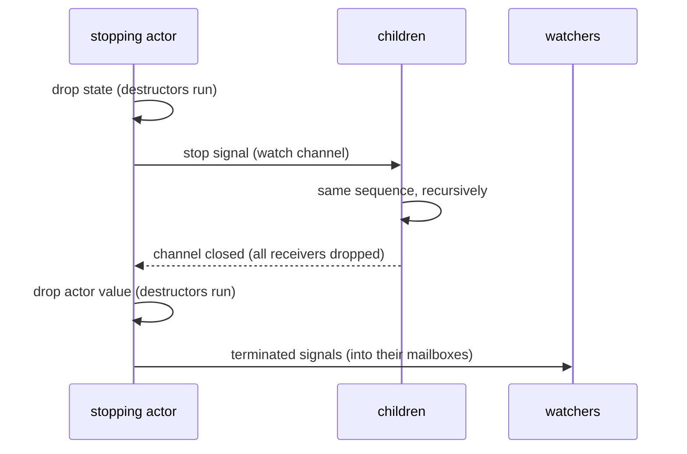

# Actors

This document explains how the tellus core works, from the public API down to the run loop:
defining actors, the actor tree, messaging, supervision and death watch. The implementation lives
in [`tellus/src`](../tellus/src). For a user-level summary see the [README](../tellus/README.md);
for event-sourced actors, which build on everything here, see [persistence.md](persistence.md).

## Overview

An actor is an independent unit of state processing one incoming message or signal at a time.
Message handling is typed and synchronous: `receive` of the [`Actor`](../tellus/src/actor.rs)
trait is a plain function from the current state and the incoming message to the next state, with
no future allocated or polled per message. Messaging via
[`ActorRef::tell`](../tellus/src/actor_ref.rs) is fire-and-forget and at-most-once, with
undeliverable messages dropped and logged as dead letters. Request-response builds on that
delivery: [`ActorRef::ask`](../tellus/src/request_response.rs) awaits a reply from outside the
actor tree and [`ActorContext::reply_to`](../tellus/src/request_response.rs) lets actors reply to
each other through their ordinary mailboxes.

Actors form a tree: an [`ActorSystem`](../tellus/src/actor_system.rs) spawns the root actor and
any actor spawns children via [`ActorContext::spawn`](../tellus/src/actor_context.rs); stopping an
actor stops its whole subtree, children first. An actor failing with an error or a panic is
stopped or restarted according to its [`SupervisionStrategy`](../tellus/src/actor_config.rs).

Death watch comes with an ordering guarantee: a terminated signal arrives behind all messages the
terminated actor has delivered to the watcher, so receiving it proves the watcher has seen every
message from that actor it will ever see.

Each actor runs as one Tokio task and owns a mailbox, unbounded by default.

## A first example

Condensed from [`01_hello.rs`](../tellus/examples/tutorials/getting_started/01_hello.rs), a root
actor which greets for the one message it receives and then stops:

```rust
let system = ActorSystem::new(Greeter);
system.root().tell(Greet("Tellus".to_string()));
system.terminated().await?;
```

```rust
impl Actor for Greeter {
    type Message = Greet;
    type Timers = Untimed;
    type State = ();
    type Error = Infallible;

    fn init(&self, _: &ActorContext<Self::Message>) -> Result<Self::State, Self::Error> {
        Ok(())
    }

    fn receive(
        &self,
        _: &ActorContext<Self::Message>,
        incoming: Incoming<Self::Message>,
        _: Self::State,
    ) -> Result<Control<Self::State>, Self::Error> {
        if let Incoming::Message(Greet(name)) = incoming {
            println!("Hello, {name}!");
        }
        Ok(Control::Stop)
    }
}
```

For a larger example see [`05_query.rs`](../tellus/examples/tutorials/getting_started/05_query.rs),
where a query actor asks every watched device for its reading and uses the ordering guarantee to
know when all readings are in.

## Defining an actor

The [`Actor`](../tellus/src/actor.rs) trait separates the actor value from its state:

- `Message` is the type of the received messages; actors which react to nothing use the
  uninhabited `Nothing`.
- `Timers` is the actor's timer mode, `Untimed` or `Timed` (see timers below); only a timed
  actor's context has `start_timer`.
- `State` is rebuilt on every restart, while the actor value itself survives; stateless actors use
  `()`.
- `Error` is the failure type of `init` and `receive`; infallible actors use `Infallible`.

`init` creates the initial state and may already spawn children or send messages. `receive` takes
the state by value and returns [`Control`](../tellus/src/actor.rs): `Continue(next_state)`
designates the state handling the next message, `Stop` stops the actor. This makes an actor a
state machine over owned values, with no interior mutability required.

[`Incoming`](../tellus/src/actor.rs) is either `Message(M)` or the `Terminated(ActorId)` signal
for a watched actor. Handling both through one `receive` keeps signals ordered relative to
messages (see death watch below).

`receive` is synchronous, so it occupies a Tokio worker for its whole duration. An actor cannot be
stopped while `receive` runs, so a `receive` which never completes keeps all ancestors from
terminating. For long running or blocking work, pipe a future to the actor itself (see piping
futures below).

## The actor tree

[`ActorSystem::new`](../tellus/src/actor_system.rs) spawns the root actor and
[`ActorContext::spawn`](../tellus/src/actor_context.rs) (available in `init` and `receive`) spawns
children, so every actor has a parent and the whole application forms a tree. Spawning returns the
child's `ActorRef` immediately; `init` runs inside the child's own task, and messages told before
it completes are queued in the mailbox.

Termination is bottom-up: a stopping actor first stops its children, each of which recursively
does the same, and only terminates itself once all descendants have. `ActorSystem::terminated`
resolves once the root, and therefore the entire tree, has terminated.

## Configuration

[`ActorConfig`](../tellus/src/actor_config.rs) is passed via `spawn_with_config` or
`ActorSystem::with_config`:

| Field                  | Default     | Meaning                                                                       |
| ---------------------- | ----------- | ----------------------------------------------------------------------------- |
| `mailbox_capacity`     | `Unbounded` | Mailbox capacity; excess messages become dead letters, with exceptions below   |
| `supervision_strategy` | `Stop`      | What happens when the actor fails: `Stop` or `Restart` with a `RestartPolicy`  |

An unbounded mailbox never drops messages, but an actor which cannot keep up grows it without limit.
A bounded mailbox applies no backpressure: sends to a full mailbox fail as dead letters, while
terminated signals, the outputs of piped futures and the replies to a `reply_to` are still
delivered.

Prefer a bounded mailbox: its capacity caps the memory taken by ordinary messages, and every dropped
message shows up as a dead letter at warn level instead of as a growing process. Size it by the
number of messages the protocol allows in flight or, failing that, by the largest burst the actor
should absorb. The default is unbounded only because no capacity fits every actor.

The capacity does not cap what the actor started itself. The outputs of its piped futures and the
replies to its `reply_to` destinations pass a full mailbox, up to one per future in flight and one
per open `ReplyTo`. Nothing limits how many of those are open. An actor which pipes a future or
opens a `reply_to` per request to a slow backend can hence hold far more than its capacity, unless
it bounds its open requests itself, e.g. with a window. An actor which stashes (see stashing below)
holds up to its capacity again in the stash.

The `serde` feature makes the whole configuration deserializable, so it can come from a config
file. The invariants it carries, `0 < min` and `min <= max` on the backoff bounds, live in
[`Backoff`](../tellus/src/backoff.rs): its fields are private and its constructor is fallible, and
deserialization is routed through that constructor via `#[serde(try_from = "...")]`. Every
container can therefore be plain public data, since no reachable `Backoff` value is invalid. A
zero minimum is rejected because it would make every step zero. The restart loop awaits the delay,
so a zero delay would let a failing `init` spin through its whole restart limit without ever
yielding.

## References and identity

An [`ActorRef`](../tellus/src/actor_ref.rs) pairs an [`ActorId`](../tellus/src/actor_id.rs) (a
UUID v7, so IDs are unique and time-ordered) with a sender, and is cheap to clone and share.
`tell` never blocks: if the actor has terminated or a bounded mailbox is full, the message is
dropped and logged as a dead letter with the actor ID and message type. Even a delivered message
may go unprocessed if the actor stops first: delivery is at-most-once, end to end.

Internally the sender is the mailbox's sending half; with the `cluster` feature it can instead be a
remote sink forwarding to an actor on another node (see the `tellus::cluster` module docs), which
also makes `ActorRef` serializable. The reference an actor gets for itself via
`ActorContext::self_ref` pairs it with the mailbox's sending half (`SelfRef` in
[`actor_ref.rs`](../tellus/src/actor_ref.rs)), which the watch mechanics below rely on.

## Request-response

Request-response is built on top of `tell`-style delivery, not beside it. A request message
carries a [`ReplyTo`](../tellus/src/request_response.rs), a single-shot destination for the reply:
the responder calls `reply` exactly once, enforced by consumption, and cannot tell how the
`ReplyTo` was created. Both creators erase their delivery mechanism behind it, so further delivery
mechanisms can be added without changing the API.

[`ActorRef::ask`](../tellus/src/request_response.rs) is the boundary API, for code outside of any
actor: `main`, tests, HTTP handlers, spawned tasks. The given function builds the request around a
oneshot-backed `ReplyTo`, the request is sent like a tell, and the returned future resolves with
the reply. Since the caller is awaiting, failures are returned instead of only logged.
`AskError::MailboxFull` or `AskError::ActorTerminated` are returned if the request cannot be sent,
with the `cluster` feature also `AskError::NotEncodable`, `AskError::TooLarge` or
`AskError::EndpointNotStarted`. Against a remote actor a full outbound queue is reported as
`MailboxFull` and an unreachable node as `ActorTerminated`. `AskError::NoReply` is returned once it
is detected that no reply can arrive anymore, i.e. when the `ReplyTo` was dropped without a reply or
the actor stopped with the request still queued. That detection is best-effort, which is why every
ask carries a timeout. `AskError::Timeout` resolves the future once the given duration has elapsed
without a reply, e.g. against a responder which keeps the `ReplyTo` alive without replying. A late
reply is dropped as a dead letter. A reply which a responder on another node cannot send is a dead
letter too, followed by a best-effort notification that no reply will come; see
[cluster.md](cluster.md).

[`ActorContext::reply_to`](../tellus/src/request_response.rs) is the actor side: it creates a
`ReplyTo` which delivers the reply into this actor's own mailbox, converted into its message type
by the given function, typically an enum variant constructor. No future is created or awaited; the
reply arrives through `receive` like any other message, in the normal mailbox FIFO. A full bounded
mailbox does not refuse the reply. The asker waits for it, and a `ReplyTo` replies at most once. So
the mailbox exceeds its capacity by at most one reply per open `ReplyTo`. The reply still counts
against the capacity, so ordinary senders are refused until the mailbox has drained back under it.
The output of a piped future is delivered the same way (see piping futures below). On the asker's
node, the reply becomes a dead letter only if the asker has terminated. A reply from another node
can also be lost on its way, e.g. to a full outbound queue on the responder's node; see
[cluster.md](cluster.md). This side has no `NoReply`: a missing reply goes unnoticed. An actor which
must detect one therefore declares `type Timers = Timed`, starts a timer per request and cancels it
once the reply has arrived (see timers below).

Supervision composes with the retained mailbox: a request queued behind a failing message survives
a restart and is answered by the restarted state, while a request consumed by the failing
`receive` itself is not redelivered and hence resolves as `NoReply`.

With the `cluster` feature a `ReplyTo` is serializable and travels inside messages to other nodes,
so both `ask` and `reply_to` work against remote actors through the same API. It then also names
the actor the reply is delivered to, if one awaits it, which keeps a remote reply ordered with
that actor's other messages. [cluster.md](cluster.md) spells out which parts of this contract
carry over the wire and where the `NoReply` detection weakens further.

## Piping futures

[`ActorContext::pipe_to_self`](../tellus/src/actor_context.rs) is how an actor uses async code
without awaiting: it spawns the given future on a new Tokio task and, once the future is ready,
delivers its output to the actor itself, converted into its message type by the given function,
just like `reply_to`. The actor keeps handling messages meanwhile. Blocking work fits the same
mould: the `JoinHandle` of `tokio::task::spawn_blocking` is itself a future to pipe.

The output is enqueued like a tell to this actor, except that a full bounded mailbox does not refuse
it. Why not drop it like a tell? Because the actor waits for it. An actor which tracks the piped
work in its state, e.g. a journal with one write in flight, would wait forever for an output dropped
as a dead letter. The delivery forces a reservation past the capacity, as a host does for the
messages it buffered (see hosts below). The count hence stays balanced: ordinary senders are refused
until the actor has drained back under its capacity. Only the actor itself pipes futures, so the
outputs past the capacity are bounded by the futures it has in flight. The output becomes a dead
letter only if the actor has terminated. The task is not tied to the actor's lifecycle: stopping
does not cancel it, since canceling at an `await` could cut an operation in half, and after a
restart its output is received by the new state, like any message queued in the retained mailbox. An
actor which must tell outputs of an earlier incarnation apart gives each request an identifier and
keeps the open ones in its state.

Polls of the future and the conversion run under `catch_unwind`, the shared
`catch_panic_and_log_async`: a panic is logged at error level with the actor ID, and no message is
delivered. A panic must not vanish silently with a discarded `JoinHandle`, else the actor would
wait for an output which never comes.

## Timers

Timers are opt-in per actor type: `type Timers = Timed;` in an `impl Actor` or `impl EventSourced`
gives the actor's `ActorContext<M, Timed>` the two methods below. With `Untimed`, the default of
`ActorContext<M>`, they do not exist, so an actor which has not declared timers cannot start one,
and it runs the loop without timers (see the run loop below). The two modes are the only
implementors of the sealed [`TimerMode`](../tellus/src/timers.rs). A function shared by timed and
untimed actors takes `&ActorContext<M, T>` with `T: TimerMode`; `&ActorContext<M>` is the untimed
context only.

[`ActorContext::start_timer`](../tellus/src/actor_context.rs) is how a timed actor messages itself
after a delay, e.g. for a deadline, a retry or an idle timeout: `start_timer(key, message, delay)`
delivers the message once the delay has elapsed. The key, a `&'static str`, names the timer:
starting a timer under a key in use replaces that timer, and `cancel_timer(key)` cancels the timer
under the key. The message of a replaced or canceled timer is dropped at once, under
`drop_containing_panic`, so a panicking destructor is logged and the actor continues.

The timer's message is delivered like a tell to itself, behind the items queued for the actor when
the timer is due, so a message which arrived before the deadline is handled before it. Unlike a
tell, a due timer takes no place in the mailbox ([`mailbox.rs`](../tellus/src/mailbox.rs)): it
does not count against the capacity of a bounded mailbox, so an actor never loses its own deadline,
and `queued` does not count it.

The run loop owns the timers: the timer table keeps one Tokio sleep, which the run loop polls.
Starting a timer moves the sleep only when the new deadline is earlier, so an idle timeout restarted
on every message costs no reset. Canceling a timer leaves the sleep alone, unless no timer remains,
which drops it. When the sleep elapses, the run loop fires every due timer: it records the timer's
position, the number of items received so far plus the number queued in the mailbox at that moment.
It reads the clock before the mailbox's length, so a timer whose deadline passes in between is left
for the next firing, behind any message queued meanwhile. It then sets the sleep to the next pending
deadline, or drops it once no timer is pending. Nothing is spawned per timer, and nothing enters the
mailbox. The run loop does so only between two items. A deadline which passes during a long
`receive`, or during the settlement of an event-sourced actor, hence fires once that has finished,
behind any message which arrived meanwhile.

A fired timer waits in the actor's timer table ([`timers.rs`](../tellus/src/timers.rs)) with its
message, and the table counts the items the run loop receives. Once that count reaches a fired
timer's position, the run loop takes the timer instead of the next item, so the timer lands right
behind the items which were queued when it fired. Those items are still there, since only the run
loop removes items, and positions never decrease, so fired timers are taken in the order they
fired. Every `start_timer` draws a new generation from a counter which only goes up. When the run
loop takes a fired timer, it looks up the timer's slot: if it still holds the timer of that
generation, the timer's message is passed to `receive`; otherwise the timer has been canceled or
replaced since, and it is dropped. A canceled or replaced timer is hence never received, even when
it was due already. The run loop takes one fired timer per iteration, received or dropped, so
skipping many stale timers still charges the cooperative budget and checks the stop signal between
them.

Which loop an actor runs is decided by its `Timers` type before its task is spawned
([`actor_context.rs`](../tellus/src/actor_context.rs)): an `Untimed` actor runs the loop without
timers, which neither polls a sleep nor counts items, and a `Timed` one the loop which does both
from its first iteration. Neither loop checks the mode. A `Timed` actor which has no timer pending
still pays for the timed loop.

A restart cancels all timers, fired ones included, since a timer encodes a deadline of the old
state; termination drops them, right after the messages drained from the mailbox (see stopping and
termination below). Either way their messages are dropped under `drop_containing_panic`, so a
panicking destructor is logged and contained.

Timers need Tokio's time driver. `start_timer` creates the sleep, so on a runtime built without the
driver it panics in the actor's own code, and the actor fails under its supervision as for any
other panic there. An `Untimed` actor needs no time driver.

In a unit test no timer fires by itself (see testing below): `TestContext::timed` creates the
context of a timed actor, [`TestContext::timers`](../tellus/src/testing.rs) lists the pending timers
with the time remaining, and `TestContext::fire_timer` fires one as the run loop would, whatever its
delay. `take_incoming` then returns its message behind the items which were queued when it fired,
unless the actor cancels or replaces the timer first.

## Stashing

An actor which waits for something, e.g. the output of a piped future, sometimes must not handle
other messages before it arrives. [`ActorContext::stash`](../tellus/src/actor_context.rs) defers
such a message. It takes the `Incoming` as `receive` got it, so a terminated signal keeps its place
behind the messages of the stopped actor, and the death watch ordering guarantee survives stashing.
`ActorContext::unstash_all` hands everything stashed to the run loop, which receives it ahead of the
mailbox, one `receive` per item and in the order it was stashed, so per-sender FIFO holds. An item
stashed again during that drain waits for the next `unstash_all`. The actor decides what it defers
and when it handles it, which keeps the explicitness of synchronous handlers; an `await` would defer
everything. Akka Typed's `StashBuffer` is the model, with three differences: a full stash hands the
item back instead of throwing, signals can be stashed, and unstashed items go through the run loop
one `receive` at a time instead of being handled inside the call.

The stash has the capacity of the mailbox: unbounded with an unbounded mailbox, `n` with a mailbox
bounded to `n`, counting the unstashed items not received yet. A full stash hands the incoming back
as the error of `stash`, and the actor decides what to do with it. A stashed item has left the
mailbox and frees its capacity, so a bounded actor holds at most twice its capacity in mailbox and
stash together. `queued` counts the mailbox only.

The stash lives on the context ([`stash.rs`](../tellus/src/stash.rs)), so it survives a restart like
the mailbox, and a drain in progress continues with the restarted state. Termination drops the
stashed items like the queued ones, under `drop_containing_panic`, so a `ReplyTo` stashed inside a
request resolves its `ask` as `NoReply`. An unstashed item skips the unwatch check of the run loop,
since the actor saw the signal when it stashed it. Unstashed items are received before a due timer,
because they arrived before its deadline (see timers above); the timer's position counts mailbox
receptions only. Event-sourced actors stash the same way through `handle`, since both run loops take
their next item through the same code. An actor which never stashes pays one length check per item
in the run loop.

In a unit test, [`TestContext::take_stashed`](../tellus/src/testing.rs) returns what the actor has
stashed and `TestContext::take_unstashed` what `unstash_all` handed to the run loop, in the order it
would be received (see testing below).

## Mailboxes

A mailbox ([`mailbox.rs`](../tellus/src/mailbox.rs)) is a FIFO channel of `Incoming<M>` split
into a `MailboxHandle` (the sending half, cloned into every `ActorRef`) and a `Mailbox` (the
receiving half, owned by the actor's run loop). Messages from one sender are received in the order
they were sent.

The underlying channel is always unbounded; a bounded mailbox is enforced by a lock-free
reservation counter ([`quota.rs`](../tellus/src/quota.rs)) in front of it: a message reserves
capacity before it is enqueued and releases it when it is received. This split is deliberate:
terminated signals and capacity answer different needs, so a terminated signal enqueues into the
same FIFO channel (preserving order behind queued messages) but bypasses the capacity check, since
a terminated signal must never be dropped.

An actor reads its own mailbox depth through `ActorContext::queued`: the number of items not
received yet, terminated signals included. Due timers are not items, so they are not counted (see
timers above), and neither are stashed items (see stashing above). An actor which writes to a
database or a socket can flush once its mailbox has run empty, and one which is overloaded can shed
load, both as part of its own protocol. For the actor itself the value is a lower bound, since only
the actor removes items. The run loop drops the terminated signals of unwatched actors before
`receive` sees them, so the count can exceed what `receive` will get by that many. `queued` takes
the channel's length under its lock, which every send and receive takes as well, so nothing is paid
until it is called. The depth is deliberately not on `ActorRef`: for a remote reference it would
need a round trip, so other actors ask through the actor's protocol. Nor is it flow control, since
senders do not see it; for that, bound the mailbox.

The mailbox also owns watcher registration ([`watch.rs`](../tellus/src/watch.rs)): watchers are
collected in a map keyed by watcher ID which termination takes and closes atomically, so a watcher
racing with termination either registers in time and is signaled, or fails registration and learns
immediately that the actor has terminated. Either way no watcher is lost. Registration is O(1) and
two-sided: watching twice registers once as a property of the map, and each watching actor records
what it watches, so `unwatch` and the watcher's own termination deregister it. Dead watchers hence
never accumulate.

## The run loop

`spawn` in [`actor_context.rs`](../tellus/src/actor_context.rs), reached via
`ActorContext::spawn_with_config` and by `spawn_root`, spawns one Tokio task per actor, with one of
two task futures chosen by the actor's `Timers` type (see timers above); event-sourced actors enter
the same loops through
[`persistence/spawn.rs`](../tellus/src/persistence/spawn.rs), described in
[persistence.md](persistence.md):

1. Run `init`; a failure is fed to supervision just like a failure of `receive`, so under
   `Restart` even the first initialization is retried.
2. Loop: wait (biased) for the parent's stop signal, a due timer, a fired timer whose position has
   been reached, or the next item from the mailbox. Fire a due timer instead of receiving anything;
   pass the message of a fired timer, or the item, to `receive`. An `Untimed` actor's loop waits
   for the stop signal and the mailbox alone.
3. Map the result to an outcome: `Continue` carries the next state, an error or panic consults the
   `SupervisionStrategy` (`Restart` or `Stop`), `Control::Stop` stops.
4. On stop, run the termination sequence below.

Both `init` and `receive` run under `catch_unwind`, so a panic is handled exactly like a returned
error: logged with the actor ID and fed to supervision. An error is logged with its source as a
separate field, so a wrapped cause stays queryable instead of being flattened into the message.
The biased select ensures a stop signal is honored before further queued messages once the parent is
stopping, and a due timer is fired before the next item is taken; for both, one item can go first
when the cooperative budget runs out. Before each wait, the loop consumes one unit of Tokio's
cooperative budget (`consume_budget`). A mailbox which never runs empty would otherwise keep the
actor's task ready forever, since flume is not part of that budget: once the budget is used up, the
actor yields its worker, so other tasks, timers and its own stop signal get to run, also on a
current-thread runtime.

## Stopping and termination

Every actor owns a Tokio watch channel; its children hold receiver clones and every child task
selects on it (the "parent stopping" branch of the run loop). The termination sequence, in
`terminate` and `stop_children` in [`actor_context.rs`](../tellus/src/actor_context.rs):



The state goes first: it is consumed by the `receive` which decided to stop, or dropped right
where the parent's stop signal is received, in both cases before the children are stopped. A
resource an actor keeps in its state is hence gone while its children may still be running; what
outlives the whole subtree belongs in the actor value.

The closed channel is the completion barrier: a child drops its receiver clone only when its task
ends, so the channel closing proves every child has terminated. Only then does the actor drop its
own value and finally signal its watchers: a terminated signal must prove that the actor's
destructors have run.

The mailbox is drained and disconnected right at the start of the sequence: senders observe the
termination while the children still stop, and the destructors of the drained messages run as part
of it, so e.g. a queued request's reply channel resolves its ask as `NoReply` instead of pending
forever. The messages of the actor's timers are dropped right after the drained ones, so a `ReplyTo`
inside one resolves its ask as `NoReply` too. A send racing with the drain can still slip past it;
such a message is retained until its last sender is dropped, which is why the `NoReply` detection is
best-effort.

The root actor has no parent, so `ActorSystem::stop` is that channel from the outside: it sends on
the very sender which keeps the root alive, shared between the system and the root's watcher
registry. Dropping a system therefore still stops nothing, since the registry holds the other
reference. The root stops where it would stop for a parent, between messages and never inside
one: the message it is handling is finished first and, for an event sourced actor, so is its
settlement, so a shutdown can lose the acknowledgement of an event but never the event. Await
`ActorSystem::terminated` for the tree to be gone. Without it a root actor needs a message of its
own for shutdown, which an actor whose message type is not its own to choose, such as a `Host`,
cannot have.

## Supervision and restarts

[`SupervisionStrategy`](../tellus/src/actor_config.rs) decides what happens when `init` or
`receive` fails: `Stop` (the default) runs the termination sequence, `Restart` rebuilds the
actor's state, limited and paced by its `RestartPolicy`.

A restart stops the children (they belong to the failed state), waits for the backoff delay, then
re-runs `init` on the same actor value: anything the actor value itself carries survives, only the
state is rebuilt. The mailbox is retained, so messages queued behind the failing one are processed
by the restarted state and keep queuing during the backoff; the failing message itself is consumed
and not redelivered. Before restarting, the loop probes whether the parent has meanwhile started
stopping and stops instead; the parent stopping also interrupts a backoff delay in progress.

Restarts are counted: the n-th counted restart is delayed by `backoff.min() * 2^(n-1)`
([`backoff.rs`](../tellus/src/backoff.rs)), capped at `backoff.max()`. When the actor fails again
after `max_restarts` counted restarts, it stops, which is how a persistent failure escalates to the
watchers. The restart count, and with it the backoff, resets once the actor has run for at least
`reset_after` without failing. Failures of `init` count the same way, including the first
initialization at spawn, so a failing initializer, e.g. one connecting to a struggling
dependency, is retried with backoff instead of looping hot.

Watches survive a restart: the restarted state can receive terminated signals for actors the
previous incarnation watched, including its own stopped children if it watched them. Timers do not:
a restart cancels them (see timers above).

## Death watch

`ActorContext::watch(other)` registers this actor as a watcher of `other`; once `other` has
terminated, this actor receives `Incoming::Terminated(other.actor_id())`. If `other` has already
terminated, registration fails and the signal is delivered right away, so watching is race-free.

`ActorContext::unwatch(other)` reverts a watch with a strong contract: after it returns, no
terminated signal for `other` is received, even if `other` has already terminated and the signal
is already enqueued. This is enforced on the watcher's side: the run loop delivers a terminated
signal only if its sender is still watched, consuming the watch, so a stale signal is dropped
before `receive` ever sees it. The same watcher-side bookkeeping deregisters a terminating actor
from everything it still watches.

With the `cluster` feature an actor on another node can be watched the same way; a synthesized
signal for a downed node then carries a weaker contract, spelled out in
[cluster.md](cluster.md).

A watcher (in [`watch.rs`](../tellus/src/watch.rs)) is essentially a sending handle into the
watching actor's own mailbox, handed to the watched actor. At termination, after its destructors
have run, the watched actor sends the terminated signal through it: into the same FIFO channel as
all the messages it delivered to the watcher before, which is the entire mechanism behind the
ordering guarantee. No coordination is needed beyond the shared queue.

At-most-once delivery bounds what the signal can prove: a message dropped as a dead letter, e.g.
told to a full bounded mailbox, never entered the queue. Receiving the signal hence proves that
the watcher has seen every message from the terminated actor it will ever see: each arrived before
the signal or was dropped as a dead letter.

## Hosts

A `Host` hosts entities: actors identified by a key, spawned on the first message for that key
and, if configured, passivated once nothing has messaged them for a while. Its own messages are
`HostEnvelope { key, message }`, so a host is spawned like any other actor and its entities are
addressed through `tell` and `ask` with an envelope. The entities are its children, hence stopping
it stops them first.

The host is given two functions. `spawn` must spawn a fresh child through the context it is
handed, on every call, e.g. via `ActorContext::spawn` or `ActorContext::spawn_event_sourced`; it
must not return an actor it has returned before, nor one from outside the host's subtree. One
entity per key, stopping the entities with the host and the delivery of buffered messages all rest
on that, and the signature cannot enforce it. `passivate` builds the message asking an entity to
stop, since an actor is stopped by itself or by its parent alone; an entity which does not stop on
that message is never passivated.

Passivation is what makes a host more than a map of references: it frees the memory of entities
nobody talks to. That is safe only where the entity's state is recoverable or disposable, which is
the case for event sourced entities, whose next incarnation replays what the store holds.

Passivation ends an entity's timers with the rest of its state, and they are not restarted
automatically in the next incarnation. An event sourced entity can record a deadline in its state
and start the timer again in `recovered`. That restores the timer only once a message has spawned
the next incarnation; nothing wakes a passivated entity at its deadline, so this is not a durable
scheduled delivery. An entity can also defer stopping on the passivate message while a deadline is
pending. From the moment the host sent that message, it buffers the messages routed through it for
that entity until the entity has stopped (see below). Messages sent to the entity's reference
directly, and its own timers, still reach the stopping incarnation.

The host cannot wake itself with a timer (see timers above), since its own message type is reserved
for its entities. It therefore spawns a ticker child per period, an actor which stops itself once
the idle timeout has elapsed: the terminated signal of that child is the sweep. The ticker holds its
sleeping task in a guard which aborts it when the ticker stops, since terminating an actor does not
cancel the tasks it spawned.

A sweep asks every entity idle for at least the timeout to stop, and only an entity whose mailbox
accepted that message counts as stopping; a full mailbox leaves it live and eligible at the next
sweep, so a passivate message is never silently lost. An entity which has not stopped by the
following sweep is logged at debug level as pending, without any claim about why: it may be
finishing a long command, a recovery or a persistence settlement before it reaches the queued
message.

While an entity stops, messages for it are buffered rather than sent, since the stopping
incarnation would process them only by accident. On its terminated signal the host spawns the
replacement, delivers the buffer in order and only then takes its next message, so one sender's
order holds across a passivation. The buffer is bounded; beyond it the newest message is refused
and logged as a dead letter, the way a full mailbox refuses one. The delivery of the buffer forces
a reservation past the entity's mailbox capacity rather than bypassing the quota, so a mailbox
smaller than the buffer loses nothing the host accepted and the count stays balanced: the
receiver releases every forced item like any other, and ordinary senders are refused until it has
drained back under its capacity.

An entity which stops on its own, e.g. under `SupervisionStrategy::Stop` after a failure, is
forgotten on its terminated signal and spawned afresh by the next message for its key.

Ownership across nodes is not part of this. A host is local: it is the single node half of the
sharded regions the roadmap describes, where the owner of a key is computed from the member list
rather than being wherever the message happened to arrive.

## Resolving `ActorSystem::terminated`

`spawn_root` in [`actor_system.rs`](../tellus/src/actor_system.rs) spawns the root actor through
the same `spawn` path as any child and registers a watcher directly in the root's watcher
registry. The watcher's handler resolves the oneshot behind `terminated()` and also owns the
sender of the root's stop channel, so the root keeps running exactly until its own termination has
signaled the watchers and drops them. If the root has already terminated when the watcher is
registered, registration fails and the oneshot is resolved right away, mirroring the race-free
watch registration. Dropping the `ActorSystem` without awaiting it does not stop the tree; the
root stops on its own terms.

## Panicking destructors

Every drop path the framework controls runs under `catch_unwind` (`drop_containing_panic` in
[`actor_context.rs`](../tellus/src/actor_context.rs)): the state dropped when the parent stops the
actor, the message of a replaced or canceled timer, the timer messages dropped at a restart, and the
actor value, the mailbox and the timer messages dropped at termination. A destructor panic is hence
logged, and what the framework was doing carries on: a replace, cancel or restart completes, and so
does termination, including the signals to the watchers. A destructor panic on a normal return of
`receive` is equally contained: when `receive` returns an error and the state's destructor panics
while the frame returns, that panic is caught like any other and fed to supervision. The locks the
framework holds itself recover from poisoning ([`sync.rs`](../tellus/src/sync.rs)), so a panic
contained by supervision cannot disable the watcher registry. A failure the framework logs, an
actor's error as well as a store error under persistence, is formatted and then dropped in two
separate unwind boundaries (`dispose_error`), so a panic in its `Display`, `source` or `Drop` is
logged and contained too, even when both formatting and destructor panic.

The one case out of reach is a panic during a panic: `init` or `receive` panics, and while that
panic unwinds, the destructor of a value still alive in the frame (the state, the message, a
local) panics as well. Rust aborts the process on a panic during unwinding, below `catch_unwind`
and hence below supervision. This is inherent to Rust, not specific to tellus: keep destructors
panic-free.

## Testing

An actor's logic can be unit tested without a running system. `init`, `receive` and the other
methods are plain synchronous functions, and the only argument which cannot be built by hand is the
`ActorContext`. With the `test-util` feature, [`TestContext`](../tellus/src/testing.rs) provides
one together with the mailbox behind it. Everything the actor sends to itself, directly or through
a `ReplyTo`, can be read back in order with `take_incoming`.

```rust
use std::convert::Infallible;
use tellus::{Actor, ActorContext, Control, Incoming, Untimed, testing::TestContext};

struct Countdown;

impl Actor for Countdown {
    type Message = u32;
    type Timers = Untimed;
    type State = u32;
    type Error = Infallible;

    fn init(&self, _: &ActorContext<Self::Message>) -> Result<Self::State, Self::Error> {
        Ok(0)
    }

    fn receive(
        &self,
        context: &ActorContext<Self::Message>,
        incoming: Incoming<Self::Message>,
        sum: Self::State,
    ) -> Result<Control<Self::State>, Self::Error> {
        let Incoming::Message(n) = incoming else {
            return Ok(Control::Stop);
        };

        if n > 0 {
            context.self_ref().tell(n - 1);
        }
        Ok(Control::Continue(sum + n))
    }
}

let mut test_context = TestContext::new();

let control = Countdown
    .receive(test_context.context(), Incoming::Message(3), 0)
    .unwrap();

assert_eq!(control, Control::Continue(3));
assert_eq!(test_context.take_incoming(), [Incoming::Message(2)]);
```

Calling an actor directly differs from running it in a few ways:

- The run loop drops a terminated signal whose sender is no longer watched; a direct call to
  `receive` sees every signal it is given.
- No timer fires by itself; `fire_timer` fires one (see timers above). `take_incoming` drops
  canceled or replaced timers for everything it returns at once, not item by item between calls to
  `receive` as the run loop does. A cancel made while handling one item hence cannot drop a timer
  behind it. To test such a cancel, pass the earlier item to `receive` directly, then call
  `take_incoming`.
- Nothing supervises the call: an error or a panic reaches the test, and nothing restarts the
  actor.
- `spawn` starts a real child actor, hence needs a Tokio runtime, for example `#[tokio::test]`.
  Dropping the `TestContext` asks the children to stop without waiting for them.
- To test `watch`, simulate the watched actor with a second `TestContext`: watch its `self_ref()`,
  then call `terminate`. Like an actor's termination, `terminate` stops the children, waits until
  every descendant has terminated and only then sends the terminated signal to the watchers.
  A `TestContext` owns neither an actor value nor a state, so a test of destructor order has to
  drop those itself.

These tests cover the actor's logic. Mailbox delivery, supervision and the ordering guarantees
described in this document belong to the run loop and have tests of their own. A test which spawns
a system, sends a message with `tell` and then reads some result mostly tests those again, and it
has to wait for the actor, since `tell` returns before the message is handled.

## Guarantees and limitations

- `tell` is fire-and-forget and at-most-once: no acknowledgements, no redelivery, dead letters
  are logged, not returned.
- Messages from one sender arrive in send order; terminated signals are ordered behind the
  watched actor's delivered messages and prove its destructors have run.
- A message sent concurrently with the termination can slip in after the mailbox was drained.
  It is a dead letter, but it and the resources it captures are retained while any `ActorRef` to
  the terminated actor lives. An `ask` whose request is such a message may time out; dropping the
  remaining references before its deadline can still resolve it as `NoReply`. The terminated
  signal's guarantee, covering the actor's state, its actor value and its descendants, is
  unaffected.
- `receive` is synchronous and cannot await; long running or blocking work runs in a future
  piped to the actor via `pipe_to_self`, whose output arrives as a message, at most once, and is
  not refused by a full bounded mailbox.
- Request-response is at-most-once too: `ask` resolves exactly once, with the reply or an error,
  at the latest when its timeout elapses, and never redelivers; a `reply_to` reply arrives at most
  once and is not refused by a full bounded mailbox. On the asker's node it becomes a dead letter
  only if the asker is gone; a reply from another node can also be lost on its way. A missing reply
  is never reported. Detecting one takes a timer per request.
- A canceled or replaced timer is never received, even when it was due already.
- A message which arrived before a timer's deadline is handled before the timer's message. The run
  loop fires a due timer between two items, so it can also land behind messages which arrived
  while the actor was busy, e.g. in a long `receive` or an event-sourced settlement.
- Stashed items are received after `unstash_all`, ahead of the mailbox and of a due timer, in the
  order they were stashed. The stash survives a restart and is dropped at termination like the
  mailbox.
- A host has at most one incarnation of an entity at any time: a replacement is spawned only once
  the previous one's terminated signal has arrived.
- A message for an entity which is stopping is enqueued to its next incarnation, in order, up to
  the configured buffer, whatever that entity's mailbox capacity; beyond the buffer the newest is
  refused and logged as a dead letter. Enqueued is the whole promise: whether the incarnation
  processes the message depends on it initialising, or recovering, and on it not stopping first,
  exactly as for any `tell`.
- An entity is asked to passivate only once it has been idle for at least the configured timeout,
  and a host checks that about once per timeout. There is no upper bound on when the entity has
  stopped: the host's own mailbox, scheduling, the entity finishing the command it is on and, for
  an event sourced entity, its settlement all come first. An entity which does not stop on its
  passivate message is never passivated, and messages for it queue in the host's buffer until it
  does.
- These guarantees are stated for actors in one process; [cluster.md](cluster.md) spells out how
  they extend to actors on other nodes and where they weaken.
